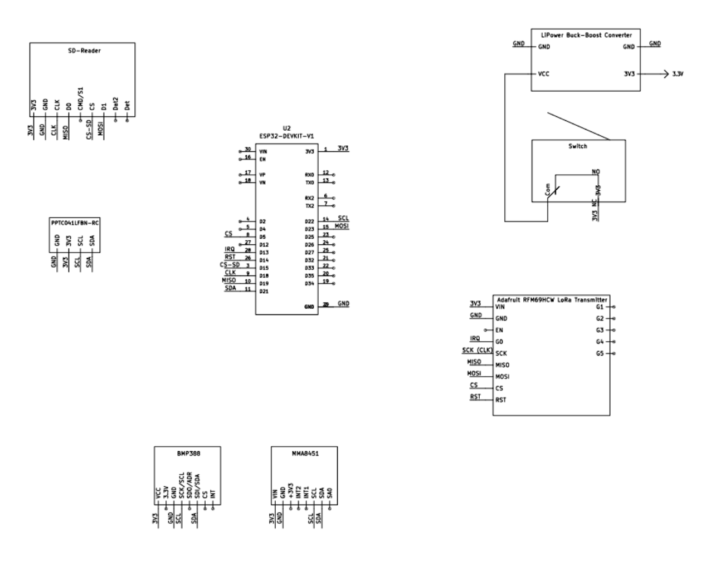

# TSAT-2B Hardware
Hardware design files for TSAT-2B.
This branch contains the KiCad schematic and PCB layout files for the telemetry subsystem.

# Electrical Architecture
## Block Diagram
The stack consists of:
Microcontroller: ESP32
RF Telemetry: Adafruit RFM69
Pressure Sensor: BMP388
Accelerometer: MMA8451
Storage: SPI SD Card Reader
Power: LiPo + Buck Converter
Switching: SPDT Power Switch

# Electrical Schematic


# Electrical Description
## Microcontroller — ESP32

The ESP32 handles:
* Communication with LoRa radio
* Communication with SD card
* I2C communication with sensors
* Packet formatting and transmission
* Data logging

## RF Subsystem
* Powered at 3.3V
* SPI interface
* Dedicated interrupt line
* Reset line from ESP32
The radio provides uplink telemetry to the ground station.

## Environmental Sensing
### Barometric Pressure
Used for:
* Altitude estimation
* Pressure readings
* Temperature

### Accelerometer
Used for:
* Orientation detection
* Motion event detection
* Vibration logging

## SD Card Subsystem
SPI SD reader for:
* data logging
* Backup telemetry storage
* Post flight analysis

# Power System
## Input
* Single-cell LiPo battery

## Regulation
buck converter provides stable 3.3V rail.

## Power Switch
Inline switch controls system power.

### Flow
```
LiPo -> Switch -> Buck Converter -> 3.3V Rail -> All Subsystems
```

# PCB Revisions
Base: Initial functional prototype
V3: Improved routing and grounding
V4: RF trace cleanup, refinements, mechanical alignment